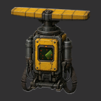

# WePlay: Cartographer Equipment



A personal radar for Factorio. Slot it into your armor or the equipment grid of your vehicle, and it charts the map around you as you move. New planets, outposts and expansion sites show up on the map without you having to drop radars everywhere.

- **Factorio:** 2.1
- **Dependencies:** base ≥ 2.1.0 (Space Age **not** required)
- **Current version:** 0.1.0

## Features

- **Charts as you go.** At a set interval, the equipment charts a square area centred on your character. The default is 256 tiles in every direction (8 chunks), well past what your character can see on its own.
- **Works in armor and vehicles.** Fits armor grids, plus `vehicle-equipment` and `universal-equipment` grids from overhaul mods when they're present. Units in the vehicle you're in count alongside the ones in your armor.
- **Quality scaling.** Higher quality units chart a wider area: +25% radius per quality level by default, so an uncommon unit reaches 25% farther and a legendary one 125% farther.
- **Reveals new ground.** By default it asks the game to generate any chunks in the charted area that don't exist yet, the way a real radar does. You can turn this off to only chart terrain that's already been generated.
- **Lightweight.** No hidden entities. The equipment is a battery that stores power, and a small script charts around each connected player on a timer.
- **Configurable.** Power draw, scan interval, radius, quality bonus and chunk generation are all mod settings.

## Getting it

Research **Cartographer equipment** (100 × automation + logistic science, 15 s each). If the base game's Modular armor technology exists, it's a prerequisite.

| Recipe | |
|---|---|
| Ingredients | 1 × Radar, 10 × Electronic circuit, 5 × Steel plate |
| Crafting time | 10 s |
| Equipment size | 2 × 2 |
| Stack size | 20 |

## How it works

The cartographer charges from your equipment grid like a battery, but never supplies power back to it. Each scan costs a fixed amount of energy:

```
energy per scan = power draw (kW) × scan interval (ticks) ÷ 60
```

With the defaults (150 kW, 120 ticks) that's 300 kJ per scan, every 2 seconds. Each unit stores two scans' worth (600 kJ) and can charge at up to twice the rated draw (300 kW), so it can catch up quickly after a dry spell.

On each scan the mod looks at your armor grid and your current vehicle's grid, picks the charged unit with the **largest range**, takes that scan's energy from it, and charts the area. If no unit has enough charge, nothing happens that scan. The square is centred on your character, so it keeps working while you look around in remote view, but not without a character (for example in god mode or the map editor).

### Multiple units

Extra units **don't stack range**. Only the best charged unit does each scan; the others act as backups for when it's out of power. If you'd like stacking, say so in the mod portal's discussion tab.

## Settings

### Startup (require a restart)

| Setting | Default | Range | What it does |
|---|---|---|---|
| Power draw (kW) | 150 | 1 – 100000 | Average power used while scanning. Sets the energy per scan and the size of the internal buffer. |
| Scan interval (ticks) | 120 | 10 – 3600 | How often the area is charted. 60 ticks = 1 second. |

### Map (can be changed mid-game)

| Setting | Default | Range | What it does |
|---|---|---|---|
| Charting radius (tiles) | 256 | 16 – 1024 | How far in each direction is charted. |
| Radius bonus per quality level (%) | 25 | 0 – 200 | Extra radius for each quality level. |
| Generate unexplored chunks | On | On / Off | Generate chunks in the charting area that don't exist yet. Turn off to only chart existing terrain. |

Large radii with chunk generation on can create a lot of new map, which increases save size and can cost performance while it's generating. If that's a concern, lower the radius or turn generation off.

## Compatibility

- Doesn't require Space Age. With Space Age it works on every planet, and quality units get the range bonus.
- Overhaul mods that add `vehicle-equipment` or `universal-equipment` grid categories are picked up automatically.
- Safe to add to an existing save. Runtime settings are reread when they change.

## Changelog

See [changelog.txt](changelog.txt).

## Author

afewvowels
